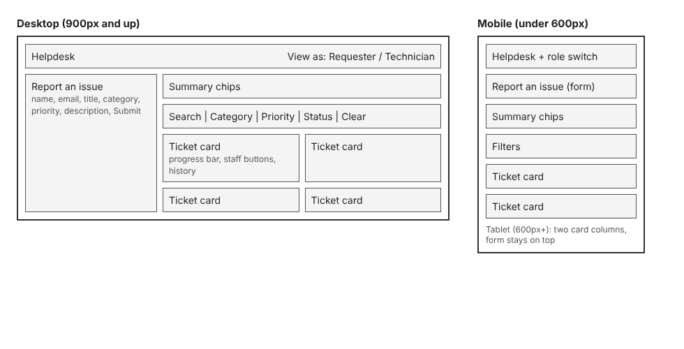
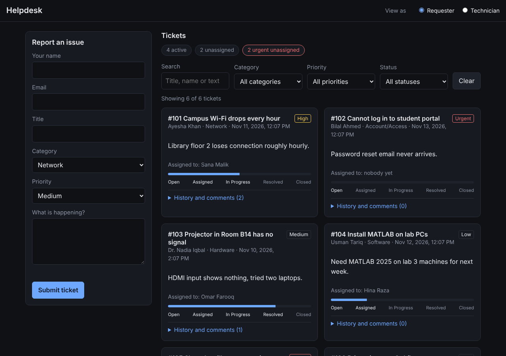
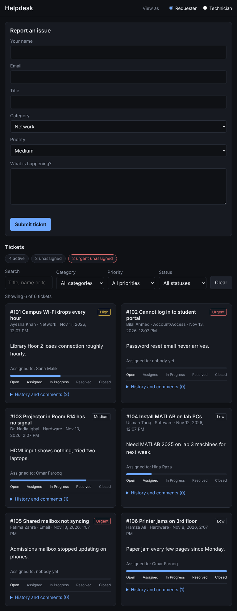
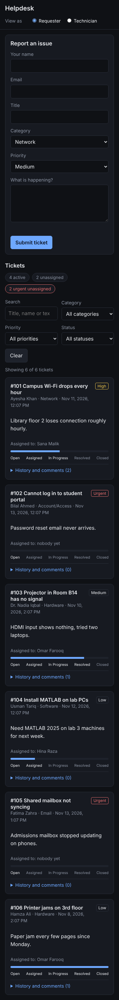
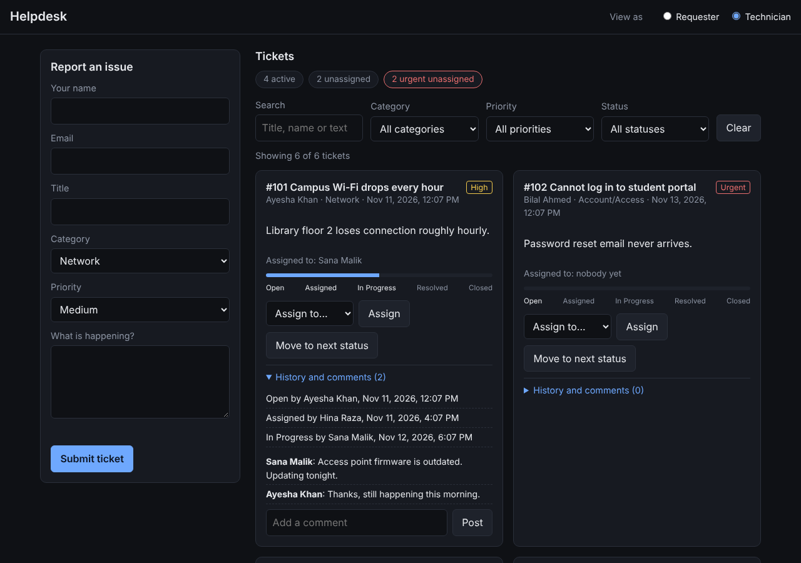
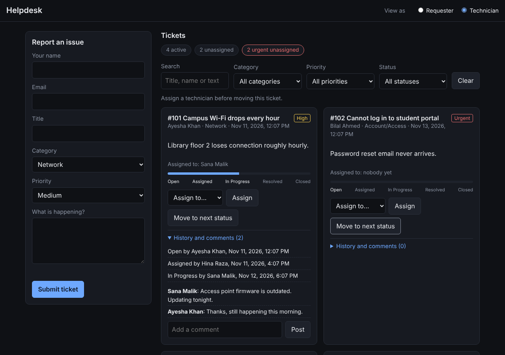
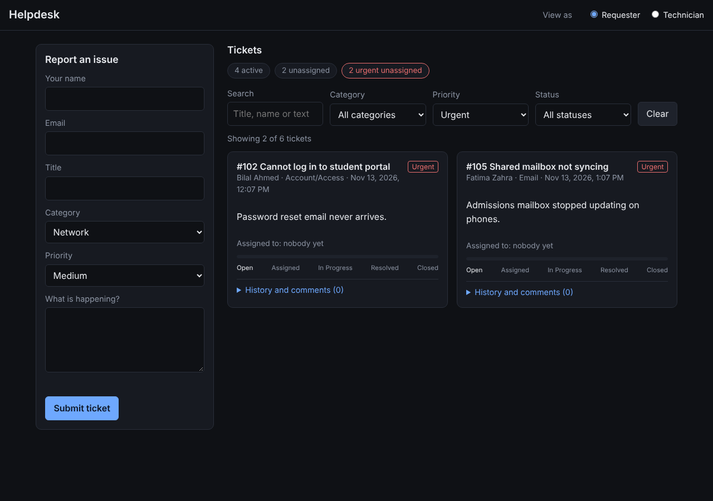
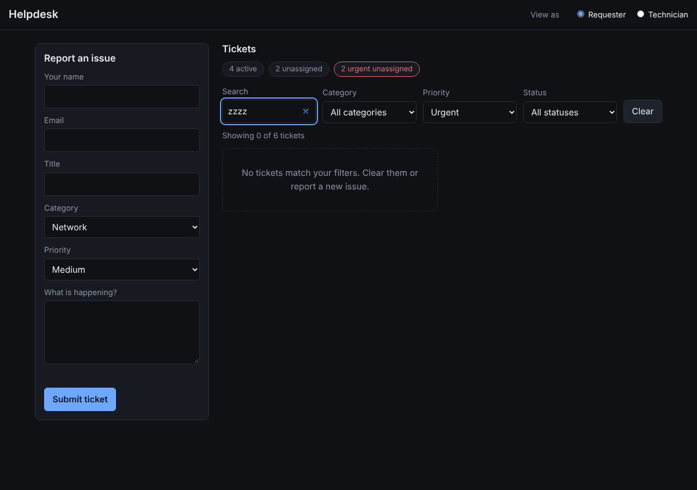
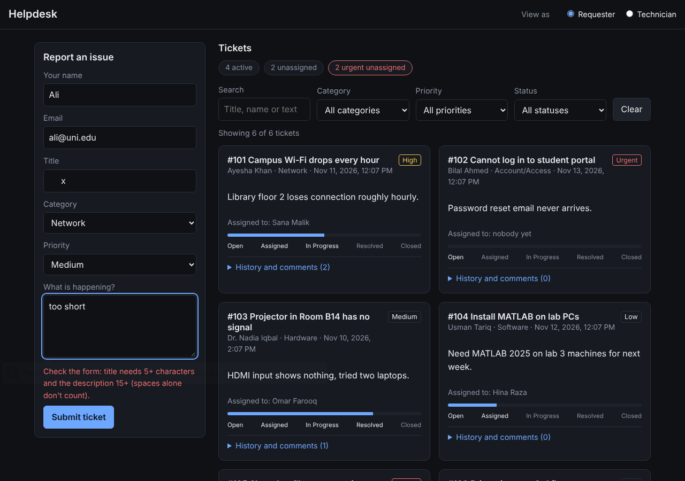
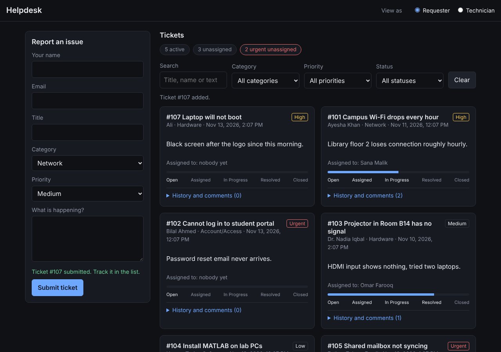

# IT Helpdesk Ticket Tracker

**Assignment 1: Client-side web application**

**Name:** Wasi Ullah

**CMS:** 517525

**SECTION:** SE-15-B

**Assigned idea:** #33 IT Helpdesk Ticket Tracker

**Live app:** [help desk](https://pakiwasi.github.io/web_engg_ass_1)

A responsive, dark-themed helpdesk. Requesters report IT problems and follow their progress. Technicians triage, assign and update tickets. It uses semantic HTML, CSS and vanilla JavaScript only, with no backend, framework or build step.

## Run it
Open `index.html` in a browser.

## Features
- **Report an issue:** labelled form with browser validation (`required`, `minlength`, `type="email"`) plus checks for whitespace-only text.
- **Search and filter** by text, category, priority and status, with a result count and an empty state.
- **Requester view:** progress bar, assignee, status history and comments.
- **Technician view:** assign a technician, move a ticket one status forward, add comments.
- **Summary chips:** active, unassigned and urgent unassigned tickets.
- **Rules:** a ticket must be assigned before it moves on, statuses only move forward, and closed tickets can't be reopened or reassigned.
- **Accessibility:** labelled inputs, `aria-live` messages, a progressbar role, visible focus outlines.

## Design note
**User and problem.** A *requester* (student or staff member) reports an IT issue and can't see what is happening with it. A *technician* needs to see what is urgent and unassigned. Workflow: submit a ticket, assign it, move it through the statuses with comments, and the requester follows the progress.

**WDLC stages.** Plan (users and scope), Analyse (fields and status rules), Design (wireframe below), Build (HTML, CSS, JS), Test (scripted and manual checks at 320, 375, 768 and 1280px), Deploy (GitHub Pages), Maintain (Assignments 2 and 3 add a server).

**Client versus server.** Running in the browser now: rendering, validation, search and filters, status rules, in-memory data and the Requester/Technician switch. Planned for a server later: saving data, real login, owner and staff authorization, server-side validation and tests. The role switch only simulates permissions, since anyone can flip it.

**Wireframe**

**Responsive layout.** Mobile first with two breakpoints: 600px (cards go to two columns) and 900px (the form sits beside the list). CSS Grid handles the page and cards, and Flexbox handles the top bar, filters and chips.

## Screenshots

| Desktop (1280px) | Tablet (768px) | Mobile (375px) |
|---|---|---|
|  |  |  |

Technician view:

| Blocked action | Filter | Empty state |
|---|---|---|
|  |  |  |

| Invalid form | Ticket submitted |
|---|---|
|  |  |

## Files
- `index.html`: page structure and forms
- `styles.css`: layout, theme and breakpoints
- `app.js`: data, ticket logic, rendering and events
- `screenshots/`: wireframe and screenshots

